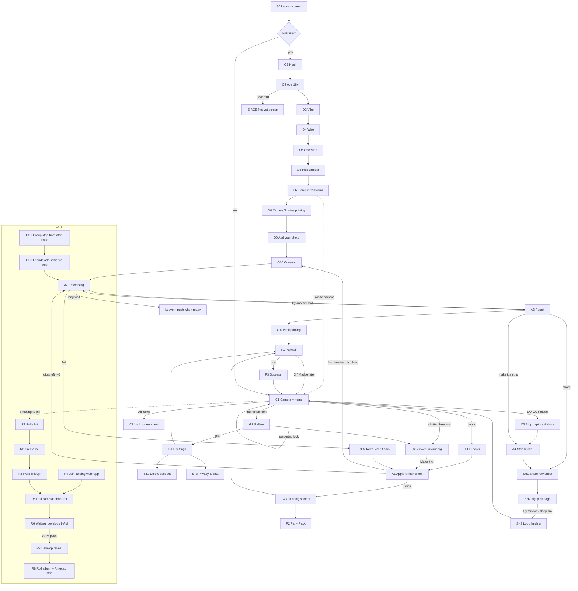

# Digi: UI/UX and every screen flow, from real apps (Nov 16, 2026)

Slice 06 of the Digi deep study. It covers the reference screens, the screen inventory and flow map, per-screen specs (with states and microcopy), a native-feel checklist and design tokens.

**Labels:**
- **V** = verified: I saw it on Mobbin, measured it, or read it in Apple's HIG today.
- **C** = commonly known or documented elsewhere, not re-checked today.
- **E** = my estimate or recommendation.

**Inputs:**
- The v2 mockup (`scratchpad/mock/digi2.html`, 6 screens: onboarding camera picker, camera, developing, result, Digi Roll, paywall).
- `DIGI-HOW-COMPETITORS-WORK-2026-11-14.md`.
- 21 Mobbin searches.
- Apple HIG pages (Accessibility, Privacy, Layout, Camera Control, Haptics, Motion), read as JSON today.

---

## 0. The 12 decisions this slice recommends (TL;DR)

1. **Camera is home** (Lapse/Snapchat pattern, V). There is no tab bar in v1:
   - top-left: gallery/settings;
   - bottom-left: last-shot thumbnail;
   - bottom-right: import;
   - above the shutter: a looks carousel.
2. **Two kinds of looks, one carousel** (E):
   - free on-device looks (instant, no badge);
   - AI looks (✦ badge, "uses 1 digi").
   - Category chips like Snapchat's "For You / Halloween" (V) become **Free · AI · Christmas · NYE**.
3. **The date stamp is burned in after the AI step, on-device** (E). The AI never sees or redraws the digits, so the stamp never comes back garbled (models are bad at drawing exact digits, C).
4. **Strip mode is a camera mode, not just an editor.** Copy Facebook's "Layout" camera mode (layout icons above the shutter, LAYOUT/NORMAL switch, V): 4 shots, 3-2-1 countdown, flash, then the strip builder.
5. **Honest progress = real stages, not a fake %** (E):
   - Upload shows a real percentage.
   - "Developing" shows elapsed time plus "usually about 20 s".
   - Past 45 s: "you can leave, we'll ping you" (the TikTok Tako pattern "5 mins left, feel free to leave", V).
   - If it fails, the digi credit comes back automatically.
6. **"Try another look" row under the result** (Art Selfie 2, V) plus **"Make it a strip"** as the main next step.
7. **Show a custom share row before the system sheet** (TikTok "Share image" row, V): Stories · Messages · TikTok · Save · Copy link · More (opens `UIActivityViewController`).
8. **Consent is a real screen, not fine print.** Use a checkbox ("Everyone in this photo said yes") plus 3 rules, styled like Glovo's declaration (V). It is remembered per photo, not per session.
9. **Ask for permissions in context:**
   - Camera when the camera first opens, using a Halide-style checklist (V).
   - Photos only on save. The import picker (PHPicker) needs no permission at all (C).
   - Notifications only after the first result or Roll, with a mock-notification preview (Luma, V).
10. **Paywall with a visible X from second 0, no countdown, no fake strike-through** (Locket clarity, V; Snapchat Lens+ uses a strike-through, so skip that).
    - Weekly, Yearly and Party Pack shown side by side.
    - If a trial is added, include the Jomo-style line "We'll remind you 24 h before" (V).
11. **Digi Roll (v1.1) copies Once + Lapse + Dispo** (all V):
    - Once: occasion question, "When does it finish?", shots per person, a visibility toggle.
    - Lapse: "Develops in 11:59:59" in a big clock font (ours is VT323).
    - Dispo: a "Shooting to: Library / Roll" switcher on the camera.
12. **Contrast fix needed:** white text on #FF4FA3 is **3.04:1** (V, measured). It passes only as bold or ≥18 pt text (HIG table, V).
    - Keep button labels ≥17 pt semibold.
    - Under Increase Contrast, switch to deep pink #D6197F (4.88:1).
    - Several mockup labels are 10.5–11 px. Raise them to ≥11 pt (caption2), ideally 12–13 pt.

---

## 1. Reference table (Mobbin + Apple)

All Mobbin links were opened through the Mobbin MCP today. I looked at the screenshots themselves, not only the metadata. **[V]**

### 1a. Camera, looks, capture modes
| # | App · screen/flow | Link | What it teaches Digi |
|---|---|---|---|
| 1 | Lapse · Developing snaps (flow, 12) | https://mobbin.com/flows/62c2320a-80ba-4c1e-8458-1e04d3f41f92 | Camera-first home: shutter centre, "developing" pile (pink stack with count) left, album right, .5/1× pill, mode tabs (MEMORIES / FUTURE ME / START ROLL). Developed shots are swiped one by one (Archive / keep) with **Undo**. |
| 2 | Lapse · Camera roll tutorial (flow) | https://mobbin.com/flows/4505017e-7a4a-4510-99da-1a24e69d3b8c | "Start a shared camera roll with friends" + "How it works ▶". A **"Develop roll in 3 / 6 / 12 hours"** wheel. **"Develops in 11:59:59"** in big yellow digits over a blurred card. This is our Digi Roll model. |
| 3 | Lapse · Onboarding (flow, 11) | https://mobbin.com/flows/96fcdd96-85ca-4d4f-9504-8d8fbdd2c050 | Permission rows (Camera ✓ / Contacts "Select" + **"Why do you need this"**) over a live blurred background. Age toggle "I am over the age of 13". Footer "Flash photography, discretion advised" (a cute flash-warning tone). |
| 4 | Lapse · Memories (flow) | https://mobbin.com/flows/15894ed7-1502-4d71-8248-613c6d603eaf | Gallery tabs Snaps / Albums / Tagged, Month/Day toggle. Empty state: "You haven't been tagged in any snaps yet · 🔒 Only you see these unless you decide to share". |
| 5 | Dispo · Taking a new Dispo | https://mobbin.com/flows/835012c1-90d7-49cb-8cd3-6046a26815b2 | **"SHOOTING TO: Library (Private) / Portra Rules! (Public)"** switcher on the camera. **9 AM / NOW** develop toggle. A skeuomorphic camera body (we skip that: our viewfinder stays big). |
| 6 | Dispo · Taking an instant Dispo | https://mobbin.com/flows/364f0268-8397-43d0-a7d5-72e52a56a0e6 | The "NOW" path skips the wait. Good for the free on-device look: instant. Only AI and Roll "develop". |
| 7 | Snapchat · lens carousel | https://mobbin.com/screens/e3815ca0-111f-465f-acb1-efdaf46d7ea0 | Looks ring the shutter. Category tabs **Favorites · For You · Halloween** (seasonal tab = our Christmas/NYE). "42%" loading on the look itself. |
| 8 | Snapchat · lens info sheet | https://mobbin.com/screens/debc7318-2e8d-493a-bac1-dd2371dc3a14 | **"This Lens uses generative AI to change your appearance."** (honest AI label). **"Made With This Lens"** row of real results = our "try this look" proof. |
| 9 | Snapchat · first-run hint | https://mobbin.com/screens/c8692292-a5f7-4efc-bcf3-883071f66833 | One coach mark only: "Swipe to try a Lens", pointing at the carousel. |
| 10 | Facebook · Layout camera mode | https://mobbin.com/screens/7290b24d-814b-4aa9-a226-26da59cf1637 | **LAYOUT / NORMAL** mode switch under the shutter, layout icons in a row above it. Exactly our live strip mode. |
| 11 | Halide Mark III · camera | https://mobbin.com/screens/c4554d5d-9a67-4797-a299-333b314a5fa1 | Pro camera chrome: AF / RAW chips, .5 / 1× / 2 pill, last-shot thumb left, a glass menu that pops over the viewfinder without leaving the camera. |
| 12 | VSCO · camera | https://mobbin.com/screens/893b687d-9903-4714-afc7-38d9142320a4 | Text mode switcher (AURORA · DSCO · VIDEO) under the shutter, exposure slider on the right edge, flash/aspect icons top. Minimal chrome. |
| 13 | Once · "How will you capture this event?" | https://mobbin.com/screens/5fae035e-bd8e-4398-87ed-bfbbc2fdc327 | A big horizontal camera card carousel with serif title. Our onboarding "Pick your party camera" is the same idea (mockup screen 1). |

### 1b. AI waiting, results, strips
| # | App · screen | Link | What it teaches |
|---|---|---|---|
| 14 | TikTok Tako · generating | https://mobbin.com/screens/a8071f22-df16-4c2f-88e3-4f372b430105 | **"Generating video… 5 mins left · Analyzing your prompt"** + "feel free to keep chatting or leave, I'll message you when it's ready" + **"1 of 2 generations used today"**. Honest time, stage name, quota. |
| 15 | ElevenLabs · image tile % | https://mobbin.com/screens/9ac366fe-f3fd-47a0-9a39-f52b9ccddf49 | The placeholder tile sits where the result will appear, with a % inside. Keeps the layout stable. |
| 16 | UNIQLO · photo processing | https://mobbin.com/screens/aa67553e-4927-429d-a66c-1b661df4387f | Step counter "5/6" + a determinate bar + "BACK". Only show % when it is real. |
| 17 | Art Selfie 2 (Google Arts & Culture) · flow | https://mobbin.com/flows/2210d548-3fa3-40fb-87cb-8dae472dfa23 | "By yourself or with friends". Result with Share / Download / Retake + **"Try another style"** carousel under it. *(from the 11-14 notes)* |
| 18 | Cursor · saved toast | https://mobbin.com/screens/1480023d-7607-409d-9c4f-3da28f236649 | A glass "✓ Saved to Photos" pill over the image, with share + download top-right. No modal. |
| 19 | CapCut · after export | https://mobbin.com/screens/08ec2870-8376-487d-a6ef-3a05eb1b5c62 | "Saved to device" header, share targets row (TikTok, IG…), "Edit another photo", **"Apply same edit to new image"** (= our "same look, new photo"). |
| 20 | Alta · regenerate | https://mobbin.com/screens/9aae0897-7b98-48c9-8ebd-d16dcfa1219c | ✕ / ✓ in the corners, "↻ Regenerate" pill under the image. Our "Redo" (one tap, says if it costs a digi). |
| 21 | Opera · result feedback | https://mobbin.com/screens/a10f6eaa-b429-452e-b997-dbdc5f59e912 | 👍/👎 next to download/share. Cheap quality signal per look (feeds the look tuning). |
| 22 | TikTok · layout picker | https://mobbin.com/screens/98e3df6c-76e8-4e11-8aed-6f0b397704df | Tabs **"2 photos · 3 photos · 4 photos…"** above layout icons, ✕ / ✓ at the bottom. The simplest strip-template picker. |
| 23 | X · collage | https://mobbin.com/screens/203b524e-b5e9-4e01-8009-7a0598dfba3b | Empty slots with "+", filled slot with "×", layout row at the bottom, colour wheel top-left (= strip frame colour). |
| 24 | CapCut · layout grid | https://mobbin.com/screens/fc97e085-906a-454d-a359-13fe4d6c9363 | 2×3 grid preview + a layout row with the selected state highlighted, "Export" top-right. |
| 25 | ChatGPT · style grid | https://mobbin.com/screens/a5c540eb-d9a9-444c-bebc-616e3f43201e | Style tiles that use **result images** as covers ("'80s flashback", "Sketch"). Look-picker grid with real outputs, never icons. |

### 1c. Groups, events, invites (Digi Roll v1.1)
| # | App · screen/flow | Link | What it teaches |
|---|---|---|---|
| 26 | Once · Creating a film (flow, 12) | https://mobbin.com/flows/62e405c1-8bc5-4d97-a77a-9a483937d0fb | "What brings you to Once?" (Wedding / Birthday / **Party** / Travelling…). **"When does your event finish?"** calendar + time. Guests count + **shots per person 5/10/16/24/36/∞**. Visibility toggle **"Everyone can see all photos"**. "Creating your special film…". Home: **Join · New**, empty "No active films", a **SAMPLE** album. |
| 27 | Once · event page | https://mobbin.com/screens/0a45f9a3-8463-4541-990d-d2443047d311 | "Alex's party": **5 Moments · 5d 2h Left · 1 People**, big camera button + QR + download, "🔒 Only the host can see everyone's photos". |
| 28 | Partiful · Creating an event (flow, 19) | https://mobbin.com/flows/1d22c2df-c904-4cb5-9e45-6f783cfa46dc | Title font chips (Classic / Eclectic / Fancy), Theme · Effect · Settings dock, a playful party tone on a dark home. |
| 29 | Partiful · Inviting (flow) | https://mobbin.com/flows/4bf25b48-6147-4b82-860b-ccc2076bb634 | Prefilled invite text "Hey [Name], Alex invited you to …! RSVP at [link]" + an optional note + "Send invites". |
| 30 | Rodeo · join collection | https://mobbin.com/screens/2ebb12e9-8477-4087-b186-17967772ad29 | Receiver landing: collage preview, "by Sam", **"Sam wants to hang."**, one black "Join collection" button. The best join screen in the set. |
| 31 | corner · create shared list | https://mobbin.com/screens/8c24cccc-238b-4b05-9906-a8c2f44b4676 | "gatekeep 🔒 collaborators and link access only" toggle. Casual privacy copy that works for Gen Z. |

### 1d. Onboarding, permissions, age, consent
| # | App · screen/flow | Link | What it teaches |
|---|---|---|---|
| 32 | Photoroom · Onboarding (flow, 13) | https://mobbin.com/flows/80139c78-5c46-460c-96e2-8f0d9f576f57 | 1–2 questions → **"Start from a photo": Select a photo / Use a sample image** → "Just like magic · Background removed!" → "Start creating". The value comes before any ask. |
| 33 | Halide · permissions | https://mobbin.com/screens/ada9e43a-f026-49f2-a19a-40be5d9bc673 | Dark checklist "TO GET STARTED, HALIDE NEEDS YOUR PERMISSION" (Camera, Photo Library, Location *Optional*) + **"Halide does not save, share, or upload any of your photos."** |
| 34 | Klarna · camera ask with fallback | https://mobbin.com/screens/e79dc9e0-830c-460d-bd79-1e1fc419ab4c | "Allow camera access" + **"Choose existing photo"**. There is always a way forward if they say no. |
| 35 | Luma · notification priming | https://mobbin.com/screens/f8b9c208-0980-466d-a9f3-696fb4cd6876 | A phone outline with 3 realistic mock notifications ("Sarah sent you a photo") + Skip. Shows the value. |
| 36 | Suno · birthday wheel (dark) | https://mobbin.com/screens/c7593217-3250-48ef-b3ee-9f86a22cde17 | Serif headline "When's your birthday?" + **"won't be shown publicly 🔒"** + a month/day/year wheel. Matches our dark/serif style. |
| 37 | Doji · good/bad photo tips | https://mobbin.com/screens/76e250b2-bb69-4df5-9133-793a45089391 | Red ✕ / green ✓ side by side ("Remove glasses and headphones") before the camera opens. |
| 38 | Glovo · photo declaration | https://mobbin.com/screens/d47fcc43-3498-431c-9b21-a975adc894d0 | "Good shot / Bad shot" + a plain declaration ("By submitting… you declare…"). A model for our consent line, made friendlier. |

### 1e. Paywall, credits, settings, errors, share
| # | App · screen/flow | Link | What it teaches |
|---|---|---|---|
| 39 | Locket · Subscribing to Gold (flow) | https://mobbin.com/flows/37926f7d-b9fd-4627-91bb-a861c883e1e2 | Benefits list → sheet with **Yearly (12 mo · Cancel anytime)** / Monthly → spinner → **"Welcome to Gold!"** success sheet + Done. Dark + one accent colour. |
| 40 | Snapchat · Lens+ paywall | https://mobbin.com/screens/d11d86f3-2f75-400f-a036-4e5f3c4f176e | The hero *is the product* (an AI look carousel in the paywall header). **Skip** its strike-through price and wall of fine print. |
| 41 | Photoroom · Pro paywall | https://mobbin.com/flows/d04549cd-1994-497e-84ef-4742670404ff | 7-day trial, "Save 65%", "Renews automatically. Cancel anytime." *(11-14 notes)* |
| 42 | Jomo · paywall trust block | https://mobbin.com/screens/355c903b-4580-4f82-bd8f-0c46195fa434 | "Can I trust you with my data?" Q&A + **"🔔 We'll notify you 24h before your trial ends!"**. Honest trial copy. |
| 43 | Joi · plans incl. lifetime | https://mobbin.com/screens/f534ccc2-5c15-4ef1-b50c-b823dd786fa6 | A one-time option listed in the same stack as the subscriptions. This is how Party Pack sits next to Weekly/Yearly. |
| 44 | Ahead · AI usage | https://mobbin.com/screens/dbee17fb-d099-432f-b798-8b920cc8a92c | **"Daily included usage 94% remaining · Refreshes in 2 hours"** + "Credits never expire". Our "digis left" screen. |
| 45 | Perplexity · out of credits | https://mobbin.com/screens/770db730-c112-4fee-a294-83bec7d315b5 | "You're out of credits. Add credits… Or, upgrade." Two honest paths, calm empty state. |
| 46 | Ahead · Manage account (flow) | https://mobbin.com/flows/851a0e00-506b-421d-acfe-1a9bc33e20db | A short settings list (Notifications, Manage subscription, Redeem, Privacy, Contact, Review) → Manage account → red "Delete account" at the bottom. |
| 47 | Brainly · Delete account (flow) | https://mobbin.com/flows/431970bb-2084-4c49-a6f9-5b3dabc8d95b | What gets lost, in bullets + an **"I understand"** checkbox that enables the button. |
| 48 | Fly Delta · scan failed | https://mobbin.com/screens/d230011e-a4a3-4daa-8ec1-08d9a38bbc52 | Error + **why** + 2–4 fix tips + one "Retry" button. The model for "no faces found". |
| 49 | Noom · "We couldn't process your photo" | https://mobbin.com/screens/46a84752-17ac-441b-b955-02f3a9ac5f34 | Human headline, cause hints (wifi, setup), single "Try again". |
| 50 | v0 · deployment error (anti-pattern) | https://mobbin.com/screens/63640548-4dd7-4a66-b9a3-48e8b0a5328c | Shows "[object Object]" to users. **Never** surface raw errors. Map every code to human copy. |
| 51 | TikTok · Share image row | https://mobbin.com/screens/e22f2696-2f84-4b46-a18f-4a811f7ad458 | Custom row (Download · SMS · WhatsApp · Email · More) before the system sheet. |
| 52 | TikTok · "Posted! Share:" | https://mobbin.com/screens/9988859d-56a0-45d8-a5c4-13928995503a | A share row drops in right after success (Copy link first). Strike while proud. |

### 1f. Apple references (read today) [V]
| Topic | URL | Key line used here |
|---|---|---|
| Accessibility | https://developer.apple.com/design/human-interface-guidelines/accessibility | iOS default control **44×44 pt** (min 28×28). Contrast **4.5:1 up to 17 pt, 3:1 at 18 pt+ or bold**. Reduce Motion: cut automatic/repetitive zoom, scale, peripheral motion. Describe UI for VoiceOver. Flashing can trigger seizures. |
| Privacy | https://developer.apple.com/design/human-interface-guidelines/privacy | "Request permission only when your app clearly needs access". Purpose string = brief, specific, sentence case, ends with a period. Process on-device where possible. |
| Layout | https://developer.apple.com/design/human-interface-guidelines/layout | Respect safe areas so the Dynamic Island and Home indicator don't cover controls. |
| Camera Control | https://developer.apple.com/design/human-interface-guidelines/camera-control | iPhone 16+ hardware button opens the app's camera. Light press shows an overlay with slider/picker controls (v1.1: map "look" to the picker). |
| Playing haptics | https://developer.apple.com/design/human-interface-guidelines/playing-haptics | Use haptics consistently, to *complement* visual feedback, short for discrete events. |
| Motion | https://developer.apple.com/design/human-interface-guidelines/motion | Brief, precise feedback beats big animation. |
| Onboarding | https://developer.apple.com/design/human-interface-guidelines/onboarding | Get people to the content fast. (Our 15 screens are one tap each, with a skip to the camera.) |
| Launching | https://developer.apple.com/design/human-interface-guidelines/launching | The launch screen should look like the first screen, not be a splash ad. |
| Sheets / Activity views / Progress / Notifications / Dark mode / Gestures | …/sheets · …/activity-views · …/progress-indicators · …/managing-notifications · …/dark-mode · …/gestures | Page URLs resolve (200). Patterns applied in §4. |
| In-app purchase | https://developer.apple.com/design/human-interface-guidelines/apple-in-app-purchase | (redirect target, V) |
| Account deletion (Guideline 5.1.1(v)) | https://developer.apple.com/help/app-review/guideline-reference/5-1-1-account-deletion | In-app account deletion is required if accounts exist (C on details). |

---

## 2. Navigation model and flow map

### 2a. Structure (E)
- **No tab bar in v1.** The camera is the root (`Stack` root). Everything else is pushed or presented as a sheet:
  - Gallery is pushed from the left.
  - The look picker, share, paywall, Party Pack and consent are sheets.
  - Processing and result are a full-screen modal stack.
- **v1.1 adds a third destination, "Rolls".** Still no tab bar: a "Shooting to:" pill (Dispo) at the top of the camera switches between *Just me* and an active roll. Rolls live in the gallery header (segmented *Digis · Strips · Rolls*).
- **Accounts:**
  - v1 uses an anonymous device account (needed for share links and purchase restore through RevenueCat's anonymous ID, C).
  - **Sign in with Apple** is offered only when someone creates or joins a Digi Roll (v1.1) or wants a backup. It is never a gate in onboarding.

### 2b. Flow map (v1 = solid, v1.1 = marked)

### 2c. Screen inventory (ID · name · version · purpose)
| ID | Screen | Ver | Purpose |
|---|---|---|---|
| S0 | Launch screen | v1 | Static black + wordmark, matches the camera bg (HIG launching). |
| O1 | Hook | v1 | "Your party's photobooth." Auto-shuffling real strips. |
| O2 | Age gate 18+ | v1 | Month/year wheel; under-18 → friendly stop. |
| O3 | Vibe | v1 | Multi-select looks (seeds carousel order). |
| O4 | Who you shoot with | v1 | Friends / partner / just me / family (seeds strip defaults). |
| O5 | Occasion | v1 | Christmas party, NYE, birthday, night out, random Tuesday (seeds seasonal tab + notif timing). |
| O6 | Pick your party camera | v1 | Choose default free look (mockup #1). |
| O7 | Sample transformation | v1 | Before→after on a sample group photo, no upload. |
| O8 | Camera + Photos priming | v1 | Halide-style checklist → system prompts. |
| O9 | Add your photo | v1 | Shoot now / pick from Photos / keep sample + tips. |
| O10 | Consent | v1 | "Everyone in this photo said yes" + rules. Reused before every new AI photo. |
| O11 | Notification priming | v1 | After first result; mock notifications. |
| C1 | Camera (home) | v1 | Free on-device digicam, looks carousel, modes NORMAL / LAYOUT (/ROLL v1.1). |
| C2 | Look picker sheet | v1 | All looks grid with result covers, Free/AI/seasonal chips, look info. |
| C3 | Strip capture | v1 | 4-shot countdown capture into a layout. |
| I1 | Import (PHPicker) | v1 | Pick 1 photo (AI) or up to 4 (strip). |
| A1 | Apply AI look sheet | v1 | Choose AI look, shows cost + digis left. |
| A2 | Processing | v1 | Honest staged progress, background allowed. |
| A3 | Result | v1 | Big result, Save / Share / Redo, Try another look, Make it a strip, 👍/👎. |
| A4 | Strip builder | v1 | Template, frame colour, caption, stamp, logo; export. |
| G1 | Gallery "My digis" | v1 | Grid, segments, select mode, empty state. |
| G2 | Viewer | v1 | Full screen, swipe, actions, hold to compare. |
| SH1 | Share row + system sheet | v1 | Stories / Messages / TikTok / Save / Copy link / More. |
| SH2 | Share page (web) | v1 | digi.pink/p/…: image, look name, "Try this look" CTA. |
| SH3 | Try-this-look landing | v1 | Deep link opens camera with the look preselected. |
| P1 | Paywall | v1 | Weekly / Yearly / Party Pack, honest. |
| P2 | Party Pack sheet | v1 | One-time 25 AI digis. |
| P3 | Purchase success | v1 | "You're in." + what unlocked. |
| P4 | Out of digis sheet | v1 | Two paths: Pack or Plus; free camera still works. |
| ST1 | Settings | v1 | Plan, digis left, restore, manage sub, stamp format, privacy, help. |
| ST2 | Delete account | v1 | Required by 5.1.1(v). |
| ST3 | Privacy & data | v1 | What's stored, for how long, delete my uploads. |
| R1–R8 | Digi Roll | v1.1 | Create, invite, join, shoot, wait, develop, album. |
| GS1–GS2 | Group strip from afar | v1.1 | Host invites; friends add selfies via web; AI strip. |
| E-* | System/error states | v1 | See §3.9. |

---

## 3. Per-screen specs (elements · states · transitions · microcopy)

Copy voice: casual, short, lowercase-friendly but not all-lowercase. No "slay", "bestie" or "vibes✨" spam. Prices said plainly. Max one emoji per screen.

### 3.1 Launch + onboarding (O1–O11)
Rules for every onboarding screen (E):
- Progress dots (the mockup's pill dots).
- Back chevron top-left (44 pt).
- One primary button at the bottom safe area.
- Every screen after O3 has a **"Skip to camera"** text button top-right. HIG onboarding says get people to the content fast, and the free camera is the content.
- Questions are single-tap and advance automatically, with a 150 ms selected state and a `selectionAsync` haptic.

| ID | Key UI | States | Microcopy |
|---|---|---|---|
| S0 | #0A0A0C, centred "digi." wordmark (pink dot). No animation (launch storyboard is static, C). | — | — |
| O1 | 3 strips fanned and slowly re-shuffling (2.4 s loop; static under Reduce Motion). Serif H1, sub, "Let's go". Fine print: Terms · Privacy. | default | **H1:** Your party's *photobooth* · **Sub:** Flash, grain, the orange date. Plus AI strips of the whole group. · **CTA:** Let's go |
| O2 | Suno-style month + year wheel (no day needed). | valid → Next enabled · under 18 → E-AGE | **H1:** Quick one: when's your birthday? · **Sub:** Digi is for 18+. We don't show this to anyone. · **CTA:** Continue · **E-AGE:** Not yet, sorry. Digi's 18+ for now. Come back on your birthday 🎂 (no retry loop; stored locally, C) |
| O3 | 2-col tiles with **real result images** as covers (ChatGPT style grid, V), multi-select with a pink ring. | 0 selected → CTA "Show me everything" | **H1:** What's the vibe? · Tiles: Night out flash · Christmas party · Soft & cute · Y2K · Paparazzi · NYE glitter |
| O4 | 4 large list rows with icons. | single | **H1:** Who's usually in the shot? · The group chat · My person · Just me · Family |
| O5 | Chips + optional date ("When is it?" sheet, Once style). | optional | **H1:** Anything coming up? · Christmas party · NYE · Birthday · Night out this week · Nothing, just vibes · *(date)* Want a reminder that day? |
| O6 | Mockup #1: fanned cards + 3 camera chips + name + description. | — | **H1:** Pick your party *camera* · **Sub:** Every look is shot like a real flash camera. Switch any time. · Names: DIGICAM FLASH · FILM 400 · PHOTO STRIP |
| O7 | A sample group photo (fictional AI-made people) "develops": blur → sharp + flash + stamp in 1.6 s, then a before/after drag handle. Two buttons. | playing · done · Reduce Motion: crossfade 300 ms | **H1:** Watch this · **Caption:** One normal group pic → digicam flash · **CTA:** Try it on mine · **Secondary:** Skip to camera |
| O8 | Halide-style card: ☐ Camera ("to shoot your digis") ☐ Photos ("to save them. You can pick 'limited'"). Line: "Your camera roll stays on your phone. We only upload the photo you choose to make AI." | not determined → asks system · denied → E-PERM-CAM | **H1:** Two quick permissions · **CTA:** Continue · Purpose strings in §3.10 |
| O9 | 3 options: Take one now (opens C1 in "first AI" mode) · Choose from Photos (PHPicker) · Use the sample. Doji ✕/✓ tips strip. | — | **H1:** Add a photo of your people · Tips: ✓ faces visible · ✓ 1–6 people · ✓ flash or good light · ✕ tiny faces far away |
| O10 | Thumbnail of the chosen photo + checkbox + 3 rules + "Make it". Checkbox **unticked by default**, so the button stays disabled until it's ticked. | unticked (disabled) · ticked | **H1:** Everyone in this photo okay with it? · ☐ **Yep, everyone here said yes and is 18+** · Rules: No one who didn't agree · No kids · Nothing explicit, it gets blocked anyway · **CTA:** Make it ✦ · Link: How we handle your photo |
| A2/A3 | First AI result (see 3.4/3.5). Free credit says "1 of 3 free". | — | — |
| O11 | Shown once, after the first result: Luma-style phone outline with 3 mock notifications. | allow → system prompt · Not now → never re-ask on launch, only in context | **H1:** Want a ping when it's ready? · Mocks: "Your digi developed ✦" · "Sara's roll develops at 9 AM" · "New drop: NYE glitter" · **CTA:** Turn on · **Secondary:** Not now |
| P1 | Paywall (3.7), soft: X visible at once. | — | — |

### 3.2 C1 Camera (home)
**Layout (top → bottom, inside safe areas):**
- **Top bar (glass circles, 44 pt):**
  - left: gallery/person icon (G1);
  - centre pill:
    - v1: **look name + "✦ 2 left"** when an AI look is selected;
    - v1.1: **"Shooting to: Just me ▾ / Sara's bday"**;
  - right: flash (Auto / On / Off; the bolt is yellow #FFD34D when On).
- **Viewfinder:** 3:4, rounded bottom 34 pt (as in the mockup).
  - Live preview with the free look applied: flash vignette, grain, colour, and the **VT323 stamp at bottom-right**.
  - The zoom pill (.5 / 1× / 2) sits bottom-centre of the viewfinder.
- **Mode switcher** (text, VSCO/Facebook style): **NORMAL · LAYOUT** (· ROLL in v1.1).
- **Looks carousel:** snaps one look per swipe (mockup: Y2K · FILM · DIGICAM · STRIP · XMAS). The selected look gets a pink dot. AI looks get ✦.
  - The first swipe onto an AI look shows a Snapchat-style info toast: "AI look · uses 1 digi · made after you shoot".
- **Bottom row:**
  - last-shot stack + count badge (left, 52 pt);
  - **shutter 78 pt** (white ring 4 pt, inner 62 pt);
  - import (right, 46 pt);
  - flip camera: double-tap the viewfinder, plus a 44 pt button in the top bar overflow (C).

**Gestures:**
- Swipe left/right on the viewfinder or carousel changes the look.
- Pinch zooms.
- Tap focuses/exposes (yellow square, auto-hides after 1.2 s).
- Double-tap flips.
- Long-press the shutter: burst? Skip (E).
- Volume buttons = shutter (C: possible with VisionCamera plus a volume listener; check Expo support). Camera Control on iPhone 16 is v1.1 (HIG).

**States:**
| State | Behaviour + copy |
|---|---|
| First open | One coach mark above the carousel: **"Swipe for looks →"** (auto-dismiss on first swipe; Snapchat V). |
| Permission not determined | Show O8 card inline (not a blank camera). |
| Permission denied | Blurred sample viewfinder + **"Camera's off for Digi"** · "Turn it on in Settings to shoot. You can still make AI digis from photos." · [Open Settings] [Choose a photo] (Klarna fallback V). |
| Simulator / no camera | "No camera here. Pick a photo instead." |
| Low light (lux estimate) | Small chip: "Dark in here, flash is on" (auto-switch flash to On once; E). |
| Front flash | Full-screen warm white flash overlay at capture (Snapchat/Instagram pattern, C). With Reduce Motion it stays (it is functional), but is limited to 150 ms with no strobe. |
| Capture | Shutter scale 0.92 → 1 (120 ms), `impactAsync(Medium)`, thumbnail flies to the stack (220 ms). Free look = **instant** result in G2, no AI. |
| AI look selected + shoot | The photo saves as a normal digi immediately, then A1 opens with the look preselected (never lose the original). |
| 0 digis + AI look | The carousel still shows AI looks with ✦ + lock. Tap opens P4, never a dead tap. |
| Thermal / perf throttled | Drop the preview effect to stamp-only and show "Preview simplified to keep your phone cool" (E). |

### 3.3 C2 Look picker sheet · C3 Strip capture · I1 Import · A1 Apply AI look
**C2 (medium detent sheet, expandable):**
- Chips: **For you · Free · AI ✦ · Christmas · NYE · New**.
- 2-col tiles with result covers, name, and a small "Free" or "✦ 1 digi" tag.
- Long-press a tile opens a **look info** half-sheet (Snapchat V):
  - before/after;
  - "This look uses AI to re-light your photo. Faces can change a bit.";
  - **"Made with this look"** row (our own approved examples in v1; user shares later).
- Empty for a seasonal chip outside its season: "Christmas looks drop Dec 1." *(only if true at runtime)*

**C3 Strip capture (LAYOUT mode):**
- Layout chips above the shutter (Facebook V): **4-cut · Classic strip · 2×2 · 2×3**.
- Viewfinder shows the current cell outlined, others dim.
- Tap shutter → **3-2-1** big VT323 countdown (orange glow) → flash → next cell. Dots show 1/4…4/4. Haptic `impactAsync(Light)` on each count and `Heavy` on capture.
- States:
  - mid-strip exit → "Ditch this strip? You've got 2 of 4." [Keep shooting] [Ditch];
  - retake a cell = tap that cell after capture.
- Done → A4.

**I1 Import:**
- System PHPicker (no Photos permission needed, C). Limits: AI = 1 photo, strip = up to 4.
- After picking:
  - On-device face count (Vision, C) → if 0 faces: E-NOFACE.
  - If >6: "That's a crowd. AI works best with 1–6 people. Try anyway?"

**A1 Apply AI look (sheet):**
- Photo preview, horizontal AI look row (result covers), cost line, CTA.
- Copy:
  - **CTA:** Make it ✦
  - **Cost line:** Uses 1 digi · 2 left
  - Plus users: "Included in Plus" (fair-use cap shown in Settings).
- If this photo hasn't had consent → O10 first.
- Offline → button disabled: "You're offline. AI needs internet, the camera doesn't."

### 3.4 A2 Processing (honest progress)
**Layout:** mockup #3.
- Blurred, saturated version of the user's own photo in a 220×290 card with a pink glow.
- Serif stage title; muted sub; a thin bar; a tip card at the bottom ("Tip: turn this into a 4-shot strip next").

**Stages (real, driven by job status; E):**
| Stage | Indicator | Title / sub |
|---|---|---|
| 1 Upload | Determinate bar (real bytes) | **Sending your photo…** · 2.1 of 3.4 MB |
| 2 Queued (only if >3 s) | Indeterminate shimmer | **In line, you're #3** *(only if the backend knows the position; else "Waiting for a free darkroom…")* |
| 3 Developing | Indeterminate shimmer + elapsed timer "0:12" | **Adding the flash ✦** · Re-lighting faces. Usually about 20 seconds. *(the p50 from the last 50 jobs of this look; shown as "about", never a countdown)* |
| 4 Finishing (on-device) | Determinate (real) | **Grain + date stamp…** |
| >45 s | Show button | **Taking longer than usual.** · You can leave, we'll ping you when it's ready. [Leave it running] |
| >120 s or error | → E-GEN | — |

**Behaviour:**
- Cancel (X, top-left) before stage 3: "Stop this one? You won't be charged." After stage 3 starts, cancelling still refunds (E: it is cheap to be generous; the cost is about $0.04).
- The app can go to the background; a local notification fires when the job completes (only if notifications are allowed), otherwise a badge on the gallery.
- Reduce Motion: no blur pulse, the bar shows a static striped pattern, the stage text crossfades.
- VoiceOver: announce stage changes (`AccessibilityInfo.announceForAccessibility`) and never more than once every 5 s.

### 3.5 A3 Result
**Layout:** mockup #4.
- Header: back · "Your digi" · ••• (Redo, Report a problem, Delete).
- Result 380 pt tall, radius 26. Look tag top-left (glass). Watermark "digi.pink" bottom-left on free (small, 13 pt, 85% white). Stamp bottom-right.
- **TRY ANOTHER LOOK** row of 66 pt thumbs (generated lazily: show the look cover until tapped; tapping = a new job, costs 1 digi, and says so in a toast the first time).
- Primary action row: **Save** (circle, 54) · **Share with the group** (pink pill) · and a secondary **"Make it a strip"** chip above the row (E: this is the upsell for the 9/10 strip).
- Hold the image = show the original (compare). The 👍/👎 pair is tucked in the ••• menu or as tiny icons under the image (Opera V).

**States:**
- Saved → glass toast "✓ Saved to Photos" (Cursor V) + `notificationAsync(Success)`.
- Photos permission denied on save → E-PERM-PHOTOS.
- Result flagged by the face check (face drift detected or 👎) → inline "Faces look off? Redo free." *(free redo once per job; E)*.
- Last free digi used → a subtle banner under the actions: "That was your last free digi. The camera's still free forever." [See options]

**Microcopy:**
- Save: Save
- Share: Share with the group
- Strip: Make it a strip
- Redo: Redo (free)
- Try another: TRY ANOTHER LOOK

### 3.6 A4 Strip builder
**Layout:**
- Strip preview centred on a dark canvas.
- Bottom panel with tabs **Layout · Frame · Text · Stamp**.
- ✕ / ✓ bottom corners (TikTok/X V), "Export" in the top right.

**Tabs:**
- **Layout:** the 4 templates (§5.6).
- **Frame:** cream #F4F1EA (default), black, pink, red/green Christmas, gold NYE, plus a custom colour wheel (X V).
- **Text:** caption line (max 24 chars; VT323 or Instrument Serif), default = occasion from O5 ("SARA'S BDAY '26").
- **Stamp:** on/off, format `'26 11 28` / `11 28 '26`, colour orange/red/yellow.
- Logo: "digi." mark on the bottom tab of the strip (free: always on; Plus: toggle).

**Sources:**
- 4 shots from C3;
- 4 picked photos;
- or **AI 4-pose strip from 1 group photo** (A1 with the "Photobooth strip" look → returns 4 frames, which are placed here and stay editable).

**Export:**
- Two files: the strip PNG at print size (§5.6) and a **9:16 story canvas** (strip centred on a blurred bg).

**States:**
- Fewer than 4 photos → empty cells with "+" (X V).
- A cell's photo is too low-res → small "!" badge "might print blurry".

### 3.7 P1 Paywall · P2 Party Pack · P3 Success · P4 Out of digis
**P1 layout:** mockup #6 (it is good).
- Hero: 3 real strips fanned.
- Serif H1 "Every party, *digi'd*".
- 3 benefit lines.
- 3 plan cards:
  - **Yearly $39.99** (badge "BEST VALUE"; sub "$0.77/week, billed yearly");
  - **Weekly $6.99** ("Cancel anytime");
  - **Party Pack $5.99** ("25 AI digis · one-time · never expire").
- Pink CTA, then the fine-print row: *Renews until cancelled · Restore · Terms · Privacy*.
- X top-right, visible immediately, 44 pt.

**Copy rules (E):**
- The CTA names the action and price: **"Get Yearly · $39.99/yr"**, **"Get Weekly · $6.99/wk"**, **"Buy Party Pack · $5.99"**.
- No "Continue" (the mockup says "Continue", so change it).
- The badge "SAVE 89%" is mathematically right vs weekly (6.99 × 52 = $363.48; $39.99 is 11% of that, V calc). "BEST VALUE" reads less like a trick. Pick one and never fake-strike prices.
- Prices come from StoreKit/RevenueCat (localized), never hard-coded (C).
- If a trial is added later: show the timeline "Today → Day 2 reminder → Day 3 billed" (5 Minute Journal / Jomo V).
- Benefits (honest, each true at launch):
  - All AI looks + new drops (only if drops are actually scheduled);
  - 4-pose photo strips;
  - No watermark, full res;
  - (v1.1) Host Digi Rolls.

**P1 states:**
- Products loading → skeleton cards (never a blank or a $0.00).
- StoreKit unavailable → "Can't reach the App Store right now. Try again in a sec." [Retry]
- Purchasing → button spinner + "Talking to Apple…" (Locket/Brilliant V).
- Cancelled → silent return (no guilt copy).
- Pending (Ask to Buy) → "Waiting for approval. We'll unlock it as soon as it's approved." (C: StoreKit pending state.)
- Failed → "Payment didn't go through. You weren't charged." [Try again]

**P2 Party Pack sheet** (when coming from P4 or "Party tonight?" entry):
- **H1:** Party tonight?
- **Sub:** 25 AI digis for $5.99. Once. No subscription. They don't expire.
- **CTA:** Buy Party Pack · $5.99
- Footnote: Plus is better if you party weekly. [See Plus]

**P3 Success** (Locket "Welcome to Gold!" V):
- **H1:** You're in ✦
- **Sub (Plus):** Every AI look is unlocked and the watermark's gone.
- **Sub (Pack):** +25 digis. You have 27.
- `notificationAsync(Success)`. **CTA:** Back to the party

**P4 Out of digis** (Perplexity V):
- **H1:** You're out of digis
- **Sub:** The camera's still free. For more AI: grab a Party Pack or go Plus.
- [Party Pack $5.99] [See Plus]

### 3.8 G1 Gallery · G2 Viewer · SH1–SH3 Share
**G1:**
- Header "My digis" (serif) + gear (ST1).
- Segmented **All · AI ✦ · Strips** (+ Rolls v1.1).
- 3-col grid, 2 pt gaps, day headers (Lapse V).
- Select mode (Snapchat numbered selection V) → Share / Save / Delete / Make a strip (if 2–4 selected).
- **Empty state:** "No digis yet" · "Your shots and AI digis land here. Only you see them unless you share." [Open camera] (Lapse privacy line V).
- **Loading:** a grey shimmer grid (max 12 cells).
- **Job in progress:** a cell with a pulsing ✦ and "developing" label (ElevenLabs tile V).

**G2:**
- Full-screen viewer, swipe between items, pinch zoom, swipe down to close (C).
- Bottom: Save · Share · Make it AI ✦ / Try another look · Strip · Delete (with confirm "Delete this digi? It's gone from Digi, not from your Photos.").

**SH1 Share row (custom, before the system sheet):**
- Row: **Stories** (Instagram Stories via URL scheme with sticker image, C) · **Messages** · **TikTok** · **Save** · **Copy link** · **More** (UIActivityViewController).
- Toggle: "Include share link" (default on).
- Copy:
  - Sheet title: Share your digi
  - After copying: Link copied (toast)
- Link creation offline → "Link needs internet. Saved to your phone for now." Image-only shares still work.

**SH2 digi.pink/p/{id} (web, dark, same tokens):**
- Image, look name, "made with Digi" and the date.
- CTA **"Try this look"** (smart banner / App Store; App Clip in v1.1, C).
- Report link.
- Copy: **"Sara made this with the Christmas Party look."**
  - Shows a first name only if the sharer set one; else "Made with the Christmas Party look".
- Meta OG image = the digi with a watermark (every share is an ad, from the 11-14 notes).
- States:
  - deleted → "This digi was deleted by its owner."
  - expired → "This link expired."
  - reported/removed → "This digi isn't available."

**SH3 Try-this-look landing (in app):**
- Opens C1 with that look selected and a one-line banner "You're trying **Christmas Party** ✦".
- If the look is paid and the user has 0 digis → banner "This one's an AI look. You've got 0 digis." [Options]

### 3.9 Errors, empty and system states (catalogue)
Rules (E):
- A human headline, a *why* line and *one* main action.
- Never show raw errors (the v0 anti-pattern, V).
- AI failure always refunds the digi automatically and says so.

| Code | Trigger | Headline · body · action |
|---|---|---|
| E-OFFLINE | No network (NetInfo) | **You're offline** · The camera works. AI and links need internet. · [Okay] (a persistent small chip on C1: "Offline · camera only") |
| E-GEN | Job failed / timeout 120 s | **That one didn't develop** · Something broke on our side. Your digi's back. · [Try again] [Pick another look] |
| E-BUSY | 429 / queue full | **Darkroom's packed** · Lots of parties tonight. Try again in a minute. Nothing was charged. · [Try again] |
| E-NOFACE | 0 faces on-device | **Can't find any faces** · Try a photo where faces are bigger and not too dark. · Tips (Fly Delta V): closer · flash on · face the camera · [Pick another] |
| E-CROWD | >6 faces | **That's a crowd** · Looks work best with 1–6 people. · [Try anyway] [Pick another] |
| E-BLOCKED | Moderation refused (nudity, minor detected, etc.) | **We can't make this one** · This photo breaks our rules (like explicit content or kids in the shot). Your digi's back. · [Pick another] [Rules] |
| E-LOWRES | <800 px short edge | **Small photo** · It might come out blurry. · [Use anyway] [Pick another] |
| E-PERM-CAM | Camera denied | (see C1 state) |
| E-PERM-PHOTOS | Save denied | **Can't save to Photos** · Digi needs "Add Photos" to save. Your digi's safe in the app. · [Open Settings] |
| E-STORAGE | Disk full | **Your phone's full** · Free up some space to save this digi. It's kept in Digi meanwhile. |
| E-PURCHASE | Payment failed | **Payment didn't go through** · You weren't charged. · [Try again] |
| E-RESTORE-NONE | Restore found nothing | **Nothing to restore** · No purchases found for this Apple ID. · [Okay] [Contact us] |
| E-LINK | Bad/expired share or roll link | **This link doesn't work anymore** · Ask your friend for a new one. |
| E-ROLL-FULL (v1.1) | Shots per person used | **You're out of shots** · 24 of 24 taken. It develops at 9 AM. |
| E-ROLL-ENDED (v1.1) | Join after develop | **This roll already developed** · Ask Sara to share the album. |
| E-AGE | Under 18 | (see O2) |
| E-GENERIC | Unknown | **Something went wrong** · Try again. If it keeps happening, tell us in Settings → Help. · (log the code to Sentry, C) |

### 3.10 Permission purpose strings (Info.plist; HIG: brief, specific, sentence case, period) [V rules, E copy]
- `NSCameraUsageDescription`: "Digi uses the camera to take your photos and strips."
- `NSPhotoLibraryAddUsageDescription`: "Digi saves your digis and strips to your photo library."
- `NSPhotoLibraryUsageDescription` (only if a custom picker is ever used; prefer PHPicker and skip this): "Digi lets you choose photos to turn into digis."
- `NSMicrophoneUsageDescription`: **not requested** (no video in v1). Expo camera plugins add it by default, so remove it with the config plugin option (C).
- Notifications (system prompt has no custom string). Priming copy in O11.

### 3.11 ST1 Settings · ST2 Delete account · ST3 Privacy
**ST1** is a grouped list on a #16161A card style (Ahead/Happier V).

**Your plan:**
- Plan row ("Free · 2 digis left" / "Plus yearly · renews Dec 16");
- **Digis left** (Ahead usage card V: "Plus includes 300 AI digis a month · 212 left · resets Dec 1"; numbers from config, E);
- **Restore purchases**;
- **Manage subscription** (opens the App Store manage sheet via `showManageSubscriptions`, C).

**Camera:**
- Date stamp (On · format `'26 11 28` / `11 28 '26` · colour);
- Save originals too (On);
- Shutter sound note: "iPhone may play the shutter sound in some regions" (C: e.g. Japan/Korea legal requirement).

**Notifications:** Roll develops · Your digi is ready · New looks (each a toggle; marketing **off by default**).

**Privacy:** Privacy & data (ST3) · Delete my uploads.

**Help:** Contact us (email) · Rules for photos · Rate Digi.

**About:** Terms · Privacy policy · Licenses (fonts: Inter/Instrument Serif/VT323 are SIL OFL, so include the notices, C) · Version.

**Danger:** **Delete account** (red, bottom).

**ST2 Delete account** (Brainly V):
- **H1:** Delete your account?
- Bullets:
  - Your digis, strips and share links are deleted from our servers.
  - Photos you saved to your phone stay.
  - Subscriptions aren't cancelled automatically. Cancel in Settings → Apple ID → Subscriptions [Manage subscription].
- Checkbox: ☐ I get it
- Button: **Delete my account** (red, disabled until ticked).
- Then a spinner → "Done. Your account's deleted." → back to O1.

Apple requires that subscription users be told how to cancel billing (C; 5.1.1(v) page, V URL).

**ST3 Privacy & data** (plain, 5 lines, Jomo "Can I trust you" tone V):
- What we upload: only the photo you choose for AI.
- How long we keep it: e.g. 30 days. Shared links: until you delete them. *(the policy must say the real number, E)*
- Who sees it: only you, unless you share.
- AI provider: name the vendor and state "not used to train models" only if that is contractually true (E).
- [Delete my uploads now]

### 3.12 Digi Roll (v1.1), detailed
| ID | Key UI (references) | States | Copy |
|---|---|---|---|
| R1 Rolls | List of active (countdown) + developed rolls; **Join · New** buttons (Once V). Empty state shows a sample roll tagged SAMPLE (Once V). | empty · active · developed | **Empty:** No rolls yet · Start one for tonight. Friends join with a link, everything develops together at 9 AM. [Start a roll] [Join with a link] |
| R2 Create | One screen: name (prefilled from O5 occasion), **Develops** (default **Tomorrow 9 AM**; wheel 3h / 6h / 12h / tomorrow 9 AM; Lapse V), **Shots each** 10/24/36 (Once V), **Who sees what before develop:** "Nobody, it's a surprise" (default) / "Host only" (Once/corner V). Host needs Plus → P1 if free (from the 11-14 notes). | needs Plus · creating | **H1:** Start a roll · **CTA:** Start roll · footnote: "Everyone in the roll agrees to be photographed. Don't add people who didn't." |
| R3 Invite | Big link chip **digi.pink/r/k7Q** + Copy · QR (Wolt/LinkedIn QR V) · prefilled message (Partiful V): "Sara started a Digi Roll for her birthday 📸 Join and shoot, it all develops tomorrow at 9 AM: digi.pink/r/k7Q" | — | **CTA:** Invite friends |
| R4 Join (web + app) | Rodeo-style: collage of blurred thumbs, "by Sara", **"Sara wants you in the roll."**, one button. If no app: App Store, then the deep link survives install (deferred deep link, C). | valid · full · ended · invalid | **CTA:** Join the roll · age + consent checkbox inline: ☐ I'm 18+ and okay being in photos |
| R5 Roll camera | C1 with the Dispo-style "Shooting to: Sara's bday ▾" pill; **"18 left"** in VT323; shots go nowhere visible (no thumbnail, just the count, a disposable feel). | shots left · 0 left (E-ROLL-FULL) | Pill: "Tonight's roll · 18 left" (mockup) |
| R6 Waiting | Mockup #5 sheet: name, started time, film-frame progress (6 of 24), avatars, "**Develops tomorrow, 9 AM**", invite button. Lapse's big countdown when <12h (VT323, pink). | active · offline queue (shots upload later; "3 shots waiting to upload") | **Sub:** Photos stay hidden till 9 AM. Everyone sees them at the same time. |
| R7 Develop reveal | A push at 9:00 local time of the **host** ("Sara's roll just developed 📸"). Swipe through one by one (Lapse V) with **Keep / Hide** (Hide = hidden only for you), then an **AI recap strip** offer. | revealing · done | **H1:** It developed. · CTA after: Make the recap strip ✦ |
| R8 Album | Grid + "Who shot it" avatars + download all + share; the host can remove a photo; anyone can **Report** (C: Guideline 1.2 for UGC requires report/block/filter + contact). | — | Report: "Report this photo" → reasons → "Thanks. We'll look within 24 hours." |

**GS1–GS2 Group strip from afar:**
- Host picks the "Group strip" look → invite link → friends open a web page, take/upload a selfie and tick consent → the host sees "3 of 4 in" → Make it ✦ → A2/A3.
- Copy: "Even if we're apart." / "Waiting on Leo and Mia."

---

## 4. Native-feel checklist (Expo / React Native)
| Area | Do this | Source |
|---|---|---|
| Safe areas | `react-native-safe-area-context` everywhere. The camera controls sit above `insets.bottom`; the top bar sits below the Dynamic Island (the mockup's top 54 pt is right for 6.1"). Test on SE (no island, 20 pt status bar) and Pro Max. | HIG Layout V; lib C |
| Dark mode | `"userInterfaceStyle": "dark"` in app.json (a camera app may be dark-only, C). Status bar light. Make the system sheets (share, StoreKit) look right on dark. | HIG Dark Mode |
| Dynamic Type | Use `allowFontScaling` (default) with `maxFontSizeMultiplier`: display serif ≤1.3, UI ≤1.6, stamp/countdown 1.0 (they are image-like). Make every row and sheet grow. Test at AX3. | HIG Accessibility V |
| Touch targets | ≥44×44 pt for every icon (the mockup's 38 pt glass circles need `hitSlop` of 3 pt or a size bump to 44). Shutter 78. Spacing ≥8 between top icons. | HIG 44×44 V |
| Contrast | Body ≥4.5:1, large/bold ≥3:1 (table §5.1). Support Increase Contrast (`AccessibilityInfo.isHighTextContrastEnabled` is Android-only, C; on iOS read `UIAccessibility.isDarkerSystemColorsEnabled` through a small native module or skip in v1, E). | HIG V |
| Reduce Motion | `AccessibilityInfo.isReduceMotionEnabled()` + listener. Swap: develop blur-pulse → crossfade; strip shuffle → static; grain animation → static; springs → 150 ms fades. Reanimated `ReduceMotion.System` (C). | HIG V |
| Flashing | Front-flash and countdown flash: one flash per capture, ≤150 ms, never repeating. No strobe effects in any look preview. | HIG Accessibility (seizure note) V |
| VoiceOver | Label every icon ("Flash, auto", "Shutter", "Look: Digicam flash, free, 3 of 12", "Gallery, 6 new"). The carousel is `accessibilityRole="adjustable"` with increment/decrement. Announce processing stages. Result image label = look name + "AI-edited photo". | HIG V |
| Haptics | `expo-haptics`: shutter `impactAsync(Medium)`; look snap `selectionAsync`; countdown tick `Light`; strip capture `Heavy`; result ready / saved / purchase `notificationAsync(Success)`; errors `notificationAsync(Error)`. Nothing else. Respect the system haptics setting (automatic). | HIG Haptics V |
| Gestures | Swipe down closes viewers and sheets. Edge swipe back on pushed screens (native-stack, C). Never override edge swipe on the camera except for the look swipe in the viewfinder centre. | HIG Gestures |
| Sheets | Native form sheets with detents (`expo-router` `presentation: "formSheet"`, `sheetAllowedDetents`, C) for look picker, share, Party Pack, consent. Grabber visible. | HIG Sheets |
| Camera performance | `react-native-vision-camera` (C) with Skia frame processors for live grain/vignette/stamp, or expo-camera with a Skia overlay if the frame processor is too heavy for the contest timeline (E: ship the overlay first; it looks 90% the same). Target 30 fps preview on an iPhone 12. Cold start → viewfinder <1.5 s (E). Pre-warm the camera session during onboarding O8. Stop the session when leaving C1 (battery/heat). | E/C |
| Capture pipeline | Capture full-res → apply look and stamp with Skia offscreen → save via `expo-media-library` (add-only). Keep the original. Never block the UI thread; show the thumbnail immediately from the preview frame. | E |
| Image picker | `expo-image-picker` (PHPicker on iOS 14+) avoids the full Photos permission (C). | C |
| Background jobs | Poll or listen (Supabase Realtime/WebSocket, C) while foregrounded; push when backgrounded. Re-attach to running jobs on launch (job IDs stored locally). | E |
| Share | `expo-sharing` / `react-native-share` (Instagram Stories needs its URL scheme + `LSApplicationQueriesSchemes`, C). Use universal links for digi.pink (Associated Domains). | C |
| Purchases | RevenueCat + StoreKit 2. Restore in Settings and on the paywall. Handle pending/Ask to Buy. Localized prices. | C |
| Keyboard | Caption field in A4: `KeyboardAvoidingView`, return = done, max 24 chars with a counter. | E |
| Empty/loading | Every list has empty, loading (skeleton) and error states (§3.9). Never a blank black screen > 300 ms. | E |
| Orientation | Portrait only in v1; rotate only the UI glyphs (flash, look name) when the phone is landscape, like the system camera (C), or skip that in the contest build. | E |
| Localization | All strings in a strings file from day one (en-US first). Dates in the stamp are not localized (it's an aesthetic), but the format is user-selectable. | E |

---

## 5. Visual system (tokens)

### 5.1 Colour (dark only), with measured contrast [V calc, WCAG formula]
| Token | Hex | Use | Contrast (on bg #0A0A0C unless noted) |
|---|---|---|---|
| `bg` | #0A0A0C | app background | — |
| `surface1` | #16161A | cards, sheets | — |
| `surface2` | #1F1F25 | inputs, secondary buttons, rows | — |
| `line` | rgba(255,255,255,.08) | hairlines, glass borders | decorative |
| `text` | #F5F3F7 | primary text | **17.94** (on surface2 14.87) ✓ |
| `textMuted` | #9C98A3 | secondary text | **7.00** (surface1 6.39, surface2 5.80) ✓ body |
| `textFaint` (new) | #6E6A75 | disabled, timestamps ≥13 pt only | 3.75 (large/bold only) |
| `pink` | #FF4FA3 | accent, selected rings, progress, pink text ≥17 pt | **6.50** ✓ as text on bg |
| `pinkSoft` | #FF8CC6 | serif italic accent words, icons on dark | **9.25** ✓ |
| `onPink` | #FFFFFF | label on pink buttons | **3.04** on pink. Passes only bold/≥18 pt. Keep CTA labels 17 pt **semibold+**, or use #0A0A0C on pink (6.50) |
| `pinkStrong` (new, Increase Contrast) | #D6197F | pink button fill when Increase Contrast is on | white on it **4.88** ✓ |
| `stamp` | #FF9A2E | date stamp, countdown | **9.34** |
| `flash` | #FFD34D | flash On, zoom selected | **13.82** |
| `danger` (new) | #FF5A5F | destructive text | **6.48** |
| `success` (new) | #3DDC97 | checkmarks, "saved" | **11.19** |
| `paper` | #F4F1EA | strip frame default | ink #0A0A0C on paper ≈ 18 (E) |
| `glass` | rgba(30,30,36,.62) + blur 14 | camera chrome over image | use a 1 px `line` border; icons pure white |
| `glow` | rgba(255,79,163,.55) | pink CTA shadow (y10, blur30) | — |

Mockup fixes (E):
1. The paywall badge text 10 px/800 → 11 pt bold min.
2. ".left" label 10.5 px → 12 pt.
3. Fine print 10.5 px → 12 pt (App Review reads it too).
4. Thumb labels 10.5 → 12 pt.

### 5.2 Type
| Role | Font | Size/line (pt) | iOS text style mapping (Dynamic Type) |
|---|---|---|---|
| Display XL | Instrument Serif 400 | 34/36, tracking −0.5 | largeTitle |
| Display L | Instrument Serif 400 | 28/32 | title1 |
| Display M (sheet titles) | Instrument Serif 400 | 30/34 → use 28 | title1 |
| Accent word | Instrument Serif *italic*, `pinkSoft` | inherit | — |
| Headline | Inter 600 | 17/22 | headline |
| Body | Inter 400 | 17/22 (mockup uses 13.5; raise body copy to 15–17) | body |
| Callout / buttons | Inter 700 | 16–17/22 | callout/headline |
| Subhead | Inter 500 | 15/20 | subheadline |
| Footnote | Inter 400 | 13/18 | footnote |
| Overline (CAPS labels: TRY ANOTHER LOOK, look names) | Inter 700, tracking 1.6 | 12/16 | caption1 |
| Caption min | Inter 500 | 11/13 | caption2 (absolute floor) |
| Digital (stamp, shots left, countdown, timers) | VT323 400 | 22 (UI) / scaled to image (stamp) | not scaled |

Note: VT323 and Instrument Serif have no bold. Never fake-bold them (E). All three fonts are OFL, so bundle them via `expo-font` with a subset (Latin) to keep the bundle small (C).

### 5.3 Spacing, radii, elevation
- **Spacing (4-pt grid):** 2 · 4 · 8 · 12 · 16 · 20 · 24 · 32 · 40 · 56.
  - Screen gutter **16** (camera, result) / **20–22** (text screens).
  - Section gap 24. List row height ≥52.
- **Radii:**
  - `xs` 6 (badges);
  - `sm` 9–12 (thumbs in stacks, chips);
  - `md` 16 (look thumbs);
  - `lg` 18–20 (cards, plan rows);
  - `xl` 24–26 (result image, develop card);
  - `sheet` 32 top;
  - `vf` 34 (viewfinder bottom);
  - `pill` 999.
  - Use continuous corners (`borderCurve: 'continuous'`, C).
- **Elevation:**
  - Dark UI uses lightness, not shadow (surface1/2).
  - The only shadows: pink CTA glow, the floating develop card (`0 0 80 rgba(255,79,163,.35)`) and strips on the paywall (`0 18 40 rgba(0,0,0,.6)`).
- **Buttons:**
  - primary 54 h / radius 27;
  - secondary 46 h;
  - icon circles 44 (mockup 38 → 44);
  - shutter 78.

### 5.4 Motion + haptics tokens
| Token | Value | Used for | Reduce Motion |
|---|---|---|---|
| `tap` | 120 ms, ease-out, scale .96 | buttons, shutter (.92) | keep (tiny) |
| `snap` | spring damping 18 / stiffness 220 | carousel snap, chip select | 150 ms timing |
| `sheet` | native | sheets | native |
| `screen` | 320 ms | modal push (A2 → A3) | 150 ms crossfade |
| `develop` | 1,200 ms: blur 18 → 0, saturation 1.6 → 1, + grain fade-in | result reveal, onboarding O7 | 300 ms crossfade |
| `flash` | 80 ms in / 150 ms out, white #FFF at 95% | capture | single flash kept |
| `toast` | 220 ms in, 2 s hold, 220 ms out | saved/copied | fade only |
| `countdown` | 1 s per digit, scale 1.2 → 1 + glow | strip capture | no scale |

Haptic map is in §4.

### 5.5 Iconography
- **Style:** a single line-icon set, 1.9 px stroke at 24 pt, round caps/joins (the mockup's SVGs). SF Symbols (`expo-symbols`, C) give native weight matching and Dynamic Type scaling, which is preferred for system concepts (share, download, gear, xmark, bolt, camera.rotate).
- **Custom glyphs** (only 4):
  - ✦ AI spark;
  - the look "camera" pictograms (mockup O6);
  - film-frame;
  - strip.
- **Colours:**
  - Icons on glass: white.
  - Active: pink or flash-yellow (for flash only).
  - Never pink + yellow in the same control.
- **App icon (E):** a black squircle, a small pink "digi." wordmark or a pink flash spark + orange VT323 date fragment. Avoid camera-lens clichés. Check at 60 px that the orange stays readable.

### 5.6 Date stamp, film grain, strip templates
**Date stamp (E unless noted):**
- **Font:** VT323, `stamp` #FF9A2E.
- **Format default:** `'26 11 28` (the classic Japanese digicam/film date-back order, C). Option: `11 28 '26`. Optional time `21:42`.
- **Size:** cap height ≈ **3.2% of the image's long edge** (on a 3024 px photo that is about 97 px font). The mockup's 22 px on a 330 px viewfinder (~6.7%) reads well in UI but is too loud on the export, so scale it separately.
- **Position:** bottom-right, inset 4% of the short edge.
- **Glow ("burned LED" look):**
  - layer 1: the text in #FF9A2E;
  - layer 2: the same text blurred 0.35% of the long edge, #FF8C28 at 85% opacity, screen blend;
  - layer 3: a 1 px warm chromatic offset (#FF3D1F at 30%, x+1).
  - Very slight overall blur (0.6 px at 1080 w).
- **Rule:** render it on-device with Skia **after** any AI output (decision #3). On strips, put one stamp per strip (on the bottom tab), not per cell.

**Film grain:**
- A monochrome fractal-noise tile, 256 px (the mockup feTurbulence, baseFrequency .9, 2 octaves).
- Blend overlay at **14–18%** opacity for "digicam", 22% for "film".
- Plus a vignette 18% (radial, 60% → 100%) and a flash hot-spot (radial white 18% at 50%/42%, as in the mockup).
- Live preview: the tile offset jumps randomly at 12 fps (static under Reduce Motion).
- Export: generate the grain at export resolution (no upscaled tile) with a per-photo random seed.

**Strip templates** (physical sizes C, pixel specs E, 300 dpi print-ready + a 2× screen export):
| Template | Physical | Export px (300 dpi) | Cells | Notes |
|---|---|---|---|---|
| **Classic US booth strip** | 2×6 in | 600×1800 (2× = 1200×3600) | 4 stacked **4:3 landscape** cells 520×390, side margin 40, gutter 20, top margin 30, bottom tab 150 px for logo + date (40+520+40 = 600; 30+4×390+3×20+150 = 1800) | The "two strips from one 4×6 print" standard (C) |
| **Korean 4-cut (인생네컷 style)** | 2×6 in | 600×1800 | 4 stacked cells 540×360 (3:2), side margin 30, thin 16 px gutters, top title band 120 px, bottom logo/date band 192 px (120+4×360+3×16+192 = 1800) | Thin frames, bold frame colours, caption band on top (C: Life4Cuts look) |
| **4-cut grid (2×2)** | 4×6 in | 1200×1800 | 2×2 cells 560×780, side margin 28, gutter 24, top margin 24, bottom tab 192 | Instagram-friendly; also prints at the drugstore |
| **2×3 grid** | 4×6 in | 1200×1800 | 2 cols × 3 rows, cells 560×500, side margin 30, gutter 20, top margin 30, tab 230 | For 6-shot Roll recaps |
| **Story canvas** | 9:16 | 1080×1920 | any strip centred at 70% height on a blurred copy of cell 1 + 30% black | the share default for IG Stories / TikTok |

The frame colour, caption and stamp sit on the frame, never on faces. The logo "digi." is at 40% opacity on paper and 60% on dark.

### 5.7 App Store screenshot style (E)
- **Consistency:** same tokens as the app.
  - #0A0A0C bg.
  - Headline in Instrument Serif 2 lines (≤6 words, one italic pink word) at the top.
  - The UI in a thin device frame or frameless with radius 44.
  - Real outputs only, with the same 4 fictional AI-made people across all shots so it reads as one party.
- **Order (first 3 carry the story):**
  1. *Your party's photobooth*: the 4-pose strip hero.
  2. *One group pic → a whole strip*: before/after.
  3. *Flash, grain, the date. Free.*: the camera.
  4. *Christmas & NYE looks*: the look grid.
  5. *Share it with the group*: share row + digi.pink page.
  6. *Everyone said yes*: consent + "your camera roll stays on your phone".
  7. (v1.1 only once shipped) *The roll develops at 9 AM*. Don't show unbuilt features (Guideline 2.3 accurate metadata, C).
- **Sizes:** produce the 6.9" set (1320×2868) and let App Store Connect scale it; check current requirements in ASC (C).
- Add a pink 4 px underline under the italic word for thumbnail-size legibility. No price claims in screenshots.

---

## 6. Copy kit (UI microcopy)
Voice: like texting a friend who's good with a camera. Short. Honest about money and AI.

**Banned:** "magic" (overused), "slay", "bestie", "unlock your creativity", fake urgency ("only today!"), guilt ("No thanks, I hate fun").

**Reusable lines:**
- Free forever: "The camera's free. Always."
- AI honesty: "AI re-lights your photo. Faces can shift a little. Redo is free if they do."
- Money: "$39.99 a year. That's about 77¢ a week." / "Cancel anytime in Settings."
- Digi = 1 AI photo. Explain once, in A1: "1 digi = 1 AI photo."

**Buttons:**
- Let's go
- Make it ✦
- Try another look
- Make it a strip
- Share with the group
- Save
- Redo (free)
- Start roll
- Join the roll
- Invite friends
- Get Yearly · $39.99/yr
- Buy Party Pack · $5.99
- Maybe later
- Restore purchases

**Toasts:**
- Saved to Photos
- Link copied
- Your digi's back (refund)
- Roll joined. Start shooting.

**Notifications (max 1/day; only opted-in types):**
- "Your digi developed ✦"
- "Sara's roll just developed 📸"
- "3 friends joined your roll"
- Seasonal (opt-in only): "NYE glitter is here. Shoot your countdown."

---

## 7. Open questions / risks for the owner
1. **Watermark on free results:** keep it small (as mocked). It is the ad. Confirm that Plus removes it everywhere, including share pages.
2. **"Save 89%" vs "Best value":** both are honest. Score: "Best value" 8/10 (reads calmer), "Save 89%" 6/10 (looks like a trick even though the maths is right).
3. **18+ gate:** it shrinks the audience (TikTok skews young), but it is the safe call for AI edits of real faces at parties. Keep it.
4. **Digi Roll host needs Plus:** fine. But let free users *join* rolls (join = growth).
5. **Contest build scope:** A4 Strip builder + C3 live strip mode are the most UI work. If time is short, ship C3 (live 4-shot) + the AI 4-pose strip with **one** template (Classic) and add the other templates in a week-2 update.
6. **Mobbin usage notice:** the Mobbin MCP reported high AI-credit usage this month (2,990 credits). Usage is unlimited during beta, but limits may come later.
